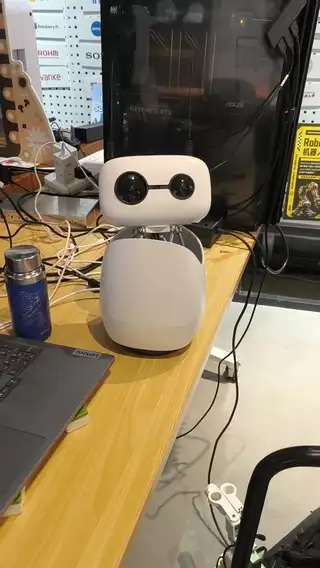

# smoothgaze — Reachy Mini face tracking

Smooth face tracking for a robot head. Built for a **Reachy Mini** — the video below is one — and written so it runs on any pan-tilt head with an optional waist axis: two angles in, three angles out, no robot SDK, about 400 lines of Python.

Face detection is the easy half. This is the half that decides whether the head looks alive or looks like a stepper motor.

**English** · [中文](README.zh-CN.md)



Full video: [assets/demo.mp4](assets/demo.mp4)

---

## The thing that is not obvious

Smoothness does not come from face detection.

Face detection answers exactly one question: where in the frame is the face. Even if that answer were perfect, sampling it once every 1.2 seconds and then snapping the head 30 degrees still looks steppy.

**All the work is in how the detection result gets used.** That is what this repo is.

Closed-loop simulation, the one bundled in `example.py`: same face motion fed to two controllers, following error in degrees.

| Scenario | This module, median / p90 | Typical naive implementation, median / p90 |
|---|---|---|
| Standing still, 25° off-center | 0.0 / 0.0 | 0.2 / 2.3 |
| Walking across the frame 40° and back | **0.3 / 9.6** | 18.8 / 36.6 |
| Pacing ±30°, 4 second period | **11.7 / 16.1** | 20.0 / 32.9 |

Reproduce it yourself with `python example.py sim`.

---

## Four decisions that make it smooth

### 1. Close the full error every frame, not half of it

A lot of implementations do "the face is off, correct 45% of the error". That hides the convergence rate inside the gain. Standing still, you cannot tell the difference. The moment the person walks, it falls behind.

The right approach is to compute, every frame, the absolute head angle at which the face would be dead center, then move there smoothly. The official Reachy Mini SDK does the same.

### 2. Compute the target from where the head WAS when the frame was captured

From capture to result there are tens of milliseconds, and the head is still turning during them. If you use the current angle as the baseline, every frame pushes a little too far, and the visible result is overshoot followed by oscillation.

So the module keeps a ring buffer of head poses and looks the baseline up by timestamp.

### 3. Adaptive smoothing

When the target moves more than 0.15 in normalized image space, the person is walking, so use a factor of 0.60 and track tightly. When it barely moves, use 0.30 and filter out detection noise.

A fixed factor forces a choice: track tightly and jitter, or stay stable and lag. The two settings are lifted from the official Reachy Mini SDK's `_AdaptiveCenterFilter`.

### 4. Solve it with the wrist before reaching for the waist

The head turns first. Only when it has been more than 45° off the body for **0.5 seconds** does the body start to help. Back inside 32°, the body stops immediately and **stays where it is** — recentering makes the whole view lurch.

While the body is catching up, the head always leads by 34°, so it keeps headroom in the direction of travel.

---

## The invisible trap: choppy is not dropped frames

This one deserves its own section because it is the most counterintuitive.

People describe their tracking as "stuttering" and immediately suspect frame drops. Measured on a real case: 15 frames per second, median inter-frame gap 63 ms, worst 90 ms, **not one gap over 200 ms**. Not a single frame was lost.

So why does it look choppy? Because the head turned 120° per second and the display only produced 15 frames per second. Two frames are 66 ms apart, and in that time the head turned **8°**. The world in your window translates 8° every 66 ms, and your eye reads that as stepping.

There are two fixes: turn the head slower, or produce frames faster. **Raising the frame rate is a pure win**, because it makes tracking more accurate at the same time. Going from 15 to 30 fps at the same 70°/s turned per-frame displacement from 8° into 2.3°, which reads as continuous.

Rule of thumb: once `vmax × frame interval` exceeds about 3°, people start calling it choppy. Watch that product while tuning.

---

## Reachy Mini, and why the code binds to no SDK

The demo video is a Reachy Mini, and the defaults are tuned on one. But the module imports no robot SDK: `tick` does only math, normalized image coordinates in and three angles out. The Reachy side is one call, handed to the head and waist:

```python
from reachy_mini.utils import create_head_pose

yaw, pitch, body = tracker.tick(1 / 40)
mini.set_target(create_head_pose(yaw=yaw, pitch=pitch, degrees=True),
                antennas=[0.0, 0.0], body_yaw=math.radians(body))
```

Swap that for your own `send_to_servos` and the rest is unchanged. It works on any structure with a two-axis head and an optional waist axis.

The reference robot is [Pollen Robotics' Reachy Mini](https://github.com/pollen-robotics/reachy_mini). Only these defaults come from its geometry:

| Default | Why this number | How to pick yours |
|---|---|---|
| `half_fov_h = 44` | Reachy camera's horizontal half field of view | Measure it, or calibrate with a checkerboard |
| `pitch_limit = 28.5` | Head pitch mechanical travel | Check your own mechanical limits |
| `rel_limit = 50` | 55° IK constraint between head and body, with margin | Same |
| `body enter = 45` | Body only moves once the head is nearly maxed out | About 80% of the relative travel |
| `head vmax = 70` | 2.3° per frame at 30 fps, no stepping | Keep frame rate × angular rate under 3° |

If your device has a head but no body, delete the `BodyGate` usage and take the head angles from `tick` directly.

---

## Install

One file, copy it into your project:

```bash
cp smoothgaze.py your_project/
```

Python 3.8 or newer, standard library only.

To use the bundled face detector you also need `opencv-python` and `numpy`:

```bash
pip install opencv-python numpy
curl -LO https://github.com/opencv/opencv_zoo/raw/main/models/face_detection_yunet/face_detection_yunet_2023mar.onnx
```

---

## Usage

```python
import time
from smoothgaze import SmoothGazeTracker

tr = SmoothGazeTracker(half_fov_h=44.0, half_fov_v=28.5)

# Vision thread: call once per frame that contains a face.
# nx / ny are the nose offset from frame center, normalized to -1..1.
tr.on_face(nx, ny, capture_ts)

# Control thread: call at 40 Hz and hand the result to your motors.
yaw, pitch, body = tr.tick(dt)
```

`tick` touches no hardware, it only does math. Drive it however you like: PCA9685, serial servos, ROS, whatever.

Full example with the bundled detector:

```python
from smoothgaze import SmoothGazeTracker
from detect_yunet import YuNetFaceDetector

det = YuNetFaceDetector("face_detection_yunet_2023mar.onnx", width=800, height=450)
tr = SmoothGazeTracker()

while True:
    ok, frame = cap.read()
    found = det.detect(frame)
    if found:
        nx, ny, score = found
        tr.on_face(nx, ny)
    yaw, pitch, body = tr.tick(1 / 40)
    send_to_servos(yaw, pitch, body)
```

---

## Aim at the nose, not the bounding box center

A detector returns a box around the face. The center of that box depends on the **hairline** and the **chin**: taller hair pushes it up, a shorter chin pulls it down. The result is a robot that is facing you but whose gaze is consistently a little off.

The nose tip does not move with your hairstyle. `detect_yunet.py` uses values 8 and 9 of YuNet's output, which are exactly the nose tip.

---

## Parameters

| Parameter | Default | Meaning |
|---|---|---|
| `half_fov_h` / `half_fov_v` | 44 / 28.5 | Camera horizontal / vertical half field of view, **must be calibrated** |
| `pipeline_ms` | 55 | Capture-to-result latency; a bad estimate causes overshoot |
| `slow` / `fast` | 0.30 / 0.60 | The two adaptive low-pass factors |
| `move_threshold` | 0.15 | Target displacement that switches to `fast` |
| `dead_zone` | 0.02 | Normalized pixel dead zone, about 0.9° |
| `max_step` | 15.0 | Max angle a single vision frame may advance |
| `head kp / vmax / amax` | 4.0 / 70 / 400 | Head gain, degrees per second, degrees per second squared. The tracker runs pitch at kp 6.0, since vertical errors are smaller |
| `head dead` | 0.4 | Head dead zone, degrees |
| `body enter / exit` | 45 / 32 | Relative angle at which the body engages / disengages |
| `body dwell` | 0.5 | How long the condition must hold before the body engages, seconds |
| `body kp / vmax / amax` | 4.0 / 30 / 90 | Body gain, degrees per second, degrees per second squared |
| `body lead` | 34 | Degrees the body always trails the head |
| `rel_limit` | 50 | Hard constraint between head and body |

**Calibrating `half_fov_h`**: put a face at the far edge of the frame, read `nx` from the detector, then turn the head until it faces the person and record how many degrees that took. Solve with `atan`. Guessing is usually off by 20%, and the symptom is "tracking gets less accurate toward the edges".

---

## What it cannot do

- **Zero latency on fast walkers.** There is a hard limit: the head has a maximum angular rate and the camera has a frame rate. Measured at 30 fps and 70°/s, a person walking at normal speed gives a p90 of about 12°. Better than that needs a higher frame rate or a faster detector.
- **Multiple faces.** It takes the largest face in the frame. Multi-person scenes need target association on top, or the head will bounce between two faces.
- **Body tracking.** It tracks faces only. When you turn your back there is no face, so it loses you and stops where it is.
- **Navigation.** It only looks, it never moves.

---

## Related

- [Reachy Mini](https://github.com/pollen-robotics/reachy_mini) — the robot head in the demo, and where the official SDK's `_AdaptiveCenterFilter` comes from
- [OpenCV Zoo: YuNet](https://github.com/opencv/opencv_zoo/tree/main/models/face_detection_yunet) — the face detector used in `detect_yunet.py`

---

## License

MIT. The face detection model is YuNet from [OpenCV Zoo](https://github.com/opencv/opencv_zoo), also MIT.
