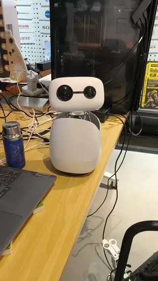

# smoothgaze — Reachy Mini 人脸跟随

让机器人的头丝滑地跟着人脸转。**Reachy Mini** 上跑的就是它，下面这段视频也是它，但代码不绑任何一台机器：只要能左右转、上下点，再有个可选的身子，两个角度进、三个角度出，约 400 行 Python，不依赖任何机器人 SDK。

人脸识别的部分其实不难，难的是识别出来之后怎么用。这个仓库就是后面那一半。

[English](README.md) · **中文**



下载完整视频：[assets/demo.mp4](assets/demo.mp4)

---

## 先说清楚一件事

丝滑不是人脸识别带来的。

人脸检测只回答一个问题：人现在在画面的哪个位置。就算这个答案百分百准确，如果后面是每 1.2 秒才看一次、看到偏了就猛转 30 度，画面照样一格一格。

**真正的功夫全在人脸识别的结果被怎么用。** 这个仓库就是那部分。

闭环仿真对比，就是 `example.py` 里自带的那段：同一段人脸运动喂给两套控制器，跟随误差单位度。

| 场景 | 本模块 中位 / p90 | 常见错误写法 中位 / p90 |
|---|---|---|
| 人站着不动，偏 25 度 | 0.0 / 0.0 | 0.2 / 2.3 |
| 人横穿画面 40 度再回来 | **0.3 / 9.6** | 18.8 / 36.6 |
| 人来回走 30 度，4 秒一圈 | **11.7 / 16.1** | 20.0 / 32.9 |

跑 `python example.py sim` 自己复现。

---

## 为什么丝滑：四个决定性的选择

### 一、每帧把误差补满，不要补一半

很多实现是「看到偏了，补 45% 的误差」。这等于把收敛速度藏进增益里——人站着不动看不出区别，人一走就跟不上。

正确的做法是每帧直接算出「脸正对镜头时头应该在哪个绝对角度」，然后平滑地过去。Reachy Mini 官方 SDK 也是这么干的。

### 二、算目标时用「拍照那一刻头在哪」

从抓帧到算出结果有几十毫秒，这段时间头还在转。如果拿当前角度当基准，每一帧都会多推一点，表现就是过冲之后来回摆。

所以模块里维护了一个姿态环形缓冲，算目标时按时间戳往回查拍照那一刻的姿态。

### 三、平滑系数自适应

目标在画面里位移超过 0.15，说明人在走，系数给 0.60 追得紧；几乎不动时给 0.30 压掉检测抖动。

固定系数只能二选一：要么跟得紧但抖，要么稳但慢。两档系数取自 Reachy Mini 官方 SDK 的 `_AdaptiveCenterFilter`。

### 四、能用手腕解决的就别动腰

头部先转。头相对底盘超过 45 度、并且**持续 0.5 秒**，底盘才开始补位；回到 32 度以内立刻停住，而且**停在那儿不回正**——回正会让画面明显晃一下。

底盘转的时候，头永远领先 34 度，给继续往前的方向留余量。

---

## 还有一个看不见的坑：画面卡不是掉帧

这一条值得单独说，因为它的反直觉程度最高。

有人会说自己的跟随「一顿一顿」，第一反应是丢帧。实测过一个典型案例：每秒 15 张，帧间隔中位 63 毫秒、最长 90 毫秒，**一次都没有超过 200 毫秒**。一张没丢。

那为什么看着卡？因为头每秒转 120 度，而画面每秒只出 15 张。两帧之间隔了 66 毫秒，头已经转了 **8 度**。你在屏幕上看到的世界每 66 毫秒平移 8 度，眼睛就把它读成「一格一格」。

解法有两个：让头转慢点，或者让画面出快点。**提帧率是纯赚的**，因为它同时让跟随更准。从 15fps 提到 30fps，同样 70 度每秒的转速，单帧位移从 8 度降到 2.3 度，就连续了。

所以：`vmax × 帧间隔` 这个乘积超过 3 度左右，人眼就开始觉得卡。调参的时候盯着它。

---

## Reachy Mini 是怎么接上去的，以及为什么不绑 SDK

上面那段视频是 Reachy Mini，默认参数也是照着它调的。但模块里不 import 任何机器人 SDK，`tick` 只做数学：归一化的画面坐标进，三个角度出。Reachy 那一侧只有一次调用：

```python
from reachy_mini.utils import create_head_pose

yaw, pitch, body = tracker.tick(1 / 40)
mini.set_target(create_head_pose(yaw=yaw, pitch=pitch, degrees=True),
                antennas=[0.0, 0.0], body_yaw=math.radians(body))
```

把这一行换成你自己的 `send_to_servos`，其余一行都不用改。换成任何「头部两轴 + 可选腰轴」的结构都能用。

参考机型是 [Pollen Robotics 的 Reachy Mini](https://github.com/pollen-robotics/reachy_mini)。需要改的只有默认值，它们来自这台机器的几何：

| 默认值 | 为什么是这个数 | 换设备时怎么定 |
|---|---|---|
| `half_fov_h = 44` | Reachy 相机的水平半视场 | 拿尺子量或者用棋盘格标定 |
| `pitch_limit = 28.5` | 头部俯仰的机械行程 | 查你自己的机械限位 |
| `rel_limit = 50` | 头相对底盘 55 度的 IK 约束留一点余量 | 同上 |
| `body enter = 45` | 头快到头了才开始动身子 | 一般取相对行程的 80% |
| `head vmax = 70` | 30fps 下单帧 2.3 度，不跳 | 帧率 × 角速度 < 3 度即可 |

如果你的设备只有一个头、没有身子，把 `BodyGate` 那一段删掉，`tick` 返回的头角度直接可用。

---

## daemon 里其实已经有一套人脸跟踪

Reachy Mini 的 SDK 自带一个：`reachy_mini/vision/face_tracking.py` 在 daemon 里跑一个 YuNet 检测线程，`start_head_tracking()` 打开它。本模块那两档 0.30 / 0.60 的系数就是从这里来的。如果你只需要「头跟着脸转」，用它就行，代码都不用自己维护。

这个模块补的是它覆盖不到的那种情况：

- **daemon 那套会独占头部。** 一旦打开，它每个控制周期都直接写头部姿态，程序里别的部分想动头就得跟它抢。一个还要点头、挥手、说话、东张西望的机器人需要仲裁，而仲裁需要一个肯让路的跟踪器。
- **这套可以随时被抢占、也看得见状态。** 每次瞄准就是设一个目标，抢占就是设一个更新的目标，你能读到它要去哪，也能在中途取消。
- **不依赖 daemon、不依赖 SDK。** `tick` 就是纯数学，跑在任何 Python 进程里。daemon 那套只存在于 daemon 内部。

如果你确实在跑 daemon，而且没有别的东西要动这个头，用自带的那套更省事。两套不要同时开，它们会把同一个头往两个方向拉。

---

## 安装

只有一个文件，直接拷过去用：

```bash
cp smoothgaze.py 你的项目/
```

需要 Python 3.8 以上，只用标准库。

如果要用现成的人脸检测，需要 `opencv-python` 和 `numpy`：

```bash
pip install opencv-python numpy
curl -LO https://github.com/opencv/opencv_zoo/raw/main/models/face_detection_yunet/face_detection_yunet_2023mar.onnx
```

---

## 用法

```python
import time
from smoothgaze import SmoothGazeTracker

tr = SmoothGazeTracker(half_fov_h=44.0, half_fov_v=28.5)

# 视觉线程：每拿到一帧人脸就调一次
# nx / ny 是鼻尖相对画面中心的归一化偏移，-1..1，0 是正中
tr.on_face(nx, ny, capture_ts)

# 控制线程：40Hz 调一次，拿回来喂给电机
yaw, pitch, body = tr.tick(dt)
```

`tick` 里不碰任何硬件，只做数学。你怎么驱动都行，PCA9685 也好，串口舵机也好，ROS 也好。

配合 `detect_yunet.py` 的完整例子：

```python
from smoothgaze import SmoothGazeTracker
from detect_yunet import YuNetFaceDetector

det = YuNetFaceDetector("face_detection_yunet_2023mar.onnx", width=800, height=450)
tr = SmoothGazeTracker()

while True:
    ok, frame = cap.read()
    found = det.detect(frame)
    if found:
        nx, ny, score = found
        tr.on_face(nx, ny)
    yaw, pitch, body = tr.tick(1 / 40)
    send_to_servos(yaw, pitch, body)
```

---

## 为什么瞄鼻尖，不瞄人脸框中心

检测器给的是一张脸的方框。框的中心受**发际线**和**下巴**影响：头发高一点框就偏上，下巴短一点框就偏下。结果是机器人「对着你」了，但视线老是偏一点。

鼻尖这个点不受发型影响，是稳定的。`detect_yunet.py` 用的是 YuNet 输出里的第 8、9 个值，那就是鼻尖。

---

## 参数表

| 参数 | 默认 | 含义 |
|---|---|---|
| `half_fov_h` / `half_fov_v` | 44 / 28.5 | 相机水平 / 垂直半视场角，**必须实测校准** |
| `pipeline_ms` | 55 | 抓帧到算出结果的延迟，估错了会过冲 |
| `slow` / `fast` | 0.30 / 0.60 | 自适应低通的两档系数 |
| `move_threshold` | 0.15 | 目标位移超过多少就切到 fast |
| `dead_zone` | 0.02 | 归一化像素死区，约 0.9 度 |
| `max_step` | 15.0 | 单个视觉帧允许推进的最大角度 |
| `head kp / vmax / amax` | 4.0 / 70 / 400 | 头部比例增益、度每秒、度每二次方秒。跟踪器里俯仰用的是 6.0，因为上下误差幅度更小 |
| `head dead` | 0.4 | 头部死区，度 |
| `body enter / exit` | 45 / 32 | 底盘介入 / 退出的相对角 |
| `body dwell` | 0.5 | 底盘介入前要持续多久，秒 |
| `body kp / vmax / amax` | 4.0 / 30 / 90 | 底盘比例增益、度每秒、度每二次方秒 |
| `body lead` | 34 | 底盘目标永远落后头多少度 |
| `rel_limit` | 50 | 头相对底盘的硬约束 |

**校准 `half_fov_h`**：把脸放在画面最左边，读检测器的 nx，然后让头只靠人眼估、转到正对，记录转了多少度。两者用 `atan` 反解。蒙的时候差 20% 很常见，效果就是「越往边上追得越不准」。

---

## 它做不到什么

- **不能让人快速走过时零延迟。** 这是物理上限：头有最大角速度，相机有帧率。实测 30fps 加 70 度每秒，人正常速度走路时 p90 大约 12 度。想更好只能提帧率或换更快的检测器。
- **单张脸。** 现在取画面里最大的那张脸。多人场景需要额外的目标关联，不然会在两张脸之间来回跳。
- **不做人体跟踪。** 只跟脸。背面朝你的时候没有脸，会跟丢并停在原地。
- **不是避障或者导航。** 只管看，不管走。

---

## 相关

- [Reachy Mini](https://github.com/pollen-robotics/reachy_mini) — 演示里那台机器人，两档平滑系数的出处 `_AdaptiveCenterFilter` 就在它的官方 SDK 里
- [OpenCV Zoo: YuNet](https://github.com/opencv/opencv_zoo/tree/main/models/face_detection_yunet) — `detect_yunet.py` 用的人脸检测模型

---

## 许可

MIT。人脸检测模型 YuNet 来自 [OpenCV Zoo](https://github.com/opencv/opencv_zoo)，同样是 MIT。
